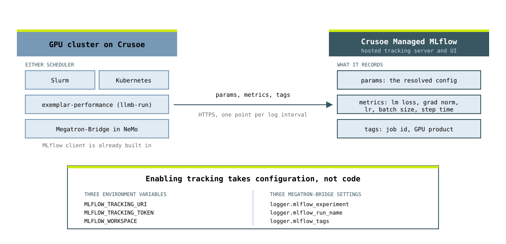

# Tracking fine-tune jobs with Crusoe Managed MLflow

[exemplar-performance](https://github.com/dsx-ai-factory/exemplar-performance/tree/v26.10.01) is NVIDIA's set of training and inference benchmarks. Its training recipes run through Megatron-Bridge, and Megatron-Bridge already has an MLflow client built in.

So adding tracking is not an integration project. You install the benchmark the way NVIDIA documents it, then add three environment variables and a few logger settings to the `llmb-run submit` command you were going to run anyway. Nothing in the benchmark changes, and the additions are the same on Slurm and on Kubernetes.

<picture>
  <source media="(prefers-color-scheme: dark)" srcset="assets/architecture-dark.svg">
  
</picture>

## What you need

**A cluster on Crusoe Cloud**, either Slurm or Kubernetes. These are full-scale benchmarks: the Llama 3 70B LoRA fine-tune below wants 8 to 16 GPUs and about 1TB of disk for its 747GB checkpoint. The smallest training run of any recipe is 8 GPUs.

**GPUs that the recipes cover.** v26.10.01 publishes workload tables for GB300, GB200, B300, B200 and H100 only. There is no A100 table, and `GPU_TYPE` does not accept one.

**Kubernetes narrows that further.** Scheduler support is set per workload, and most recipes are Slurm only. At v26.10.01 the Kubernetes-capable training workloads are:

| GPU family | Workloads that run on Kubernetes | Smallest scale |
| --- | --- | --- |
| GB300 | Qwen3 30B, Nemotron 3.5 Lightning, Llama 3.1 8B MLPerf, Llama 3.1 70B, GPT OSS 120B, Nemotron 3 Super, DeepSeek V4 Flash | 8 GPUs |
| GB200, B300, B200 | Nemotron 3.5 Lightning, DeepSeek V4 Flash | 8 GPUs |
| H100 | none, every H100 training workload is Slurm only | n/a |

So if your Kubernetes cluster is H100 or older, use the Slurm path instead. The MLflow settings in step 4 are the same either way.

**The software exemplar-performance expects.** The full list is in its [Prerequisites](https://github.com/dsx-ai-factory/exemplar-performance/tree/v26.10.01#prerequisites). Split by where it has to be:

| Where | What |
| --- | --- |
| The host you run `install.sh` on | **Linux**, Bash 4.2 or newer, Git and Git LFS, and an [NGC account](https://org.ngc.nvidia.com/setup) for the container images. A stock macOS laptop will not do: it ships Bash 3.2. Use the Slurm login or compute node, or any Linux box whose kubeconfig points at the cluster. You do not need to install Python yourself, since `install.sh` fetches `uv` and builds its own Python 3.12 environment. |
| The GPU nodes | CUDA 12.3+ (12.8+ recommended), NVIDIA driver 535.129.03+, NCCL 2.19.4+, OFED 5.9+ |
| Slurm | Slurm 22.x+ built `--with-pmix` (check with `srun --mpi=list`), the `task/affinity` plugin, [Enroot](https://github.com/NVIDIA/enroot/) 4.0.0+ with its [extra hooks](https://github.com/NVIDIA/enroot/tree/main/conf/hooks/extra) in `/etc/enroot/hooks.d/`, and [Pyxis](https://github.com/NVIDIA/pyxis) |
| Kubernetes | `kubectl`, `helm` and `nvcrectl` on the installer host's `PATH`, plus the [KAI Scheduler](https://github.com/kai-scheduler/KAI-Scheduler) on the cluster (step 2). `nvcrectl` is NVIDIA's nvcre control tool and is not on a public download page; ask your NVIDIA contact for it. |

**A Managed MLflow workspace and a Crusoe API key**, both created in the [Crusoe Console](https://console.crusoecloud.com/). Managed MLflow is in private preview, so [request access](https://www.crusoe.ai/managed-mlflow/request) if your organization does not have it yet.

**A Hugging Face token** with approved access to the gated model you plan to run, for example [Llama 3 70B](https://huggingface.co/meta-llama/Meta-Llama-3-70B-Instruct). Approval is not automatic and can take a day.

## 1. Get to the cluster

**Slurm:** SSH to the login node.

```bash
ssh <user>@<login-node>
```

**Kubernetes:** point your kubeconfig at the cluster by name.

```bash
crusoe kubernetes clusters get-credentials <your cluster name>
kubectl config use-context <your cluster name>
kubectl get nodes
```

Add `--project-name <project>` if your Crusoe account has more than one project.

## 2. Install exemplar-performance

### Kubernetes only: install the KAI Scheduler first

Multi-node jobs need gang scheduling so that all pods of a job start together. The installer records `gang_scheduler_name: kai-scheduler` but does not install or check for it, so without this step job pods sit in `Pending` forever.

```bash
kubectl get pods -n kai-scheduler
```

If that namespace is empty or missing, install it (cluster-admin permissions required) and wait for the pods to reach `Running`:

```bash
export KAI_VERSION=v0.18.2
helm upgrade -i kai-scheduler \
  oci://ghcr.io/kai-scheduler/kai-scheduler/kai-scheduler \
  -n kai-scheduler --create-namespace \
  --version $KAI_VERSION
```

### Both schedulers: install the benchmark

On Slurm, run this from a compute node rather than the login node, since it pulls large container images and downloads the checkpoint.

```bash
sudo apt-get install -y git-lfs
git clone --branch v26.10.01 https://github.com/dsx-ai-factory/exemplar-performance
cd exemplar-performance
export HF_TOKEN=<your huggingface token>
./install.sh
```

`install.sh` first installs `uv`, builds a Python 3.12 virtualenv called `llmb_venv` one directory above the repo, and puts `llmb-run` and `llmb-install` in it. Then it turns interactive, and the first question is the cluster type:

```text
Cluster Type
------------
 'slurm':      Jobs are submitted to a SLURM-managed cluster.
 'kubernetes': Jobs run as Kubernetes WorkloadRun custom resources (nvcre/nvcrectl).
```

After that it asks for a workload directory, which becomes `$LLMB_INSTALL` and holds every artifact from here on, and for the workloads to install. Slurm also asks for your account and partition. Kubernetes asks for the namespace to submit into, a kubeconfig path, image pull secret names, an NGC API key if you named pull secrets, an optional PVC, and whether to run `nvcrectl setup init`. Answers are written to `cluster_config.yaml` in `$LLMB_INSTALL`.

It needs a terminal, so do not pipe anything into it. If it exits with `Error: EOFError`, it was reading a prompt from an empty stdin.

Check the install:

```bash
# source ../llmb_venv/bin/activate
# llmb-run list
Available workloads:
==================================================

finetune_llama3:
  70b:
    Data types: bf16, fp8
    Scales: 8, 16 (exact matches only)

pretrain_llama3.1:
  70b:
    Data types: bf16, fp8
    Scales: 64, 128, 256, 512
  405b:
    Data types: bf16, fp8
    Scales: 1024

```

Every workload, model size, data type and scale you selected should appear. If the virtualenv is somewhere else, its path is under `workloads.config.<workload>.venv_path` in `cluster_config.yaml`.

## 3. Point it at Crusoe Managed MLflow

These three variables are the entire connection. Keep them in a file readable only by the job's user and source it at submit time.

```bash
export MLFLOW_TRACKING_URI=https://api.mlflow.crusoecloud.com
export MLFLOW_TRACKING_TOKEN=<your crusoe api key>
export MLFLOW_WORKSPACE=<your workspace name>
export EXPERIMENT=<your experiment name>
```

`MLFLOW_WORKSPACE` is what puts the run in your team's workspace. A workspace is MLflow's multi-tenancy boundary, so experiments, runs and registered models inside one are not visible from any other.

## 4. Submit the benchmark with tracking on

The `--env` flags carry the connection into the job. The `--mbridge-arg` settings are what make Megatron-Bridge open the run. Both are ordinary `llmb-run submit` options, so the benchmark command is otherwise unchanged.

### Slurm

The Llama 3 70B LoRA fine-tune, which is the workload in the companion blog post. It is Slurm only.

```bash
cd $LLMB_INSTALL
llmb-run submit -w finetune_llama3 -s 70b --dtype bf16 --scale 16 \
  --env MLFLOW_TRACKING_URI="$MLFLOW_TRACKING_URI" \
  --env MLFLOW_TRACKING_TOKEN="$MLFLOW_TRACKING_TOKEN" \
  --env MLFLOW_WORKSPACE="$MLFLOW_WORKSPACE" \
  --mbridge-arg "logger.mlflow_experiment=$EXPERIMENT" \
  --mbridge-arg 'logger.mlflow_run_name=llama3-70b-lora-bf16-16gpu-job$SLURM_JOB_ID' \
  --mbridge-arg 'logger.mlflow_tags={slurm_job_id:job$SLURM_JOB_ID}' \
  --mbridge-arg logger.mlflow_log_artifacts=false
```

Run it again with `--dtype fp8` to get a second run to compare against.

### Kubernetes

`finetune_llama3` is Slurm only, so pick one of the Kubernetes-capable workloads from the table in [What you need](#what-you-need). The command below is the repo's own Kubernetes example, which needs GB300 and at least 8 GPUs. The MLflow additions are identical to the Slurm ones:

```bash
cd $LLMB_INSTALL
llmb-run submit -w pretrain_qwen3 -s 30b_a3b --dtype bf16 --scale 8 \
  --env MLFLOW_TRACKING_URI="$MLFLOW_TRACKING_URI" \
  --env MLFLOW_TRACKING_TOKEN="$MLFLOW_TRACKING_TOKEN" \
  --env MLFLOW_WORKSPACE="$MLFLOW_WORKSPACE" \
  --mbridge-arg "logger.mlflow_experiment=$EXPERIMENT" \
  --mbridge-arg "logger.mlflow_run_name=qwen3-30b-bf16-8gpu" \
  --mbridge-arg logger.mlflow_log_artifacts=false
```

A `--mbridge-arg` value cannot contain whitespace, so quote the whole option when it holds shell syntax.

## 5. Watch the job

```bash
llmb-run jobs                        # every job, with status, elapsed time, s/iter and TFLOPS/GPU
llmb-run jobs show <job_id>          # one job in full
llmb-run jobs log <job_id> --follow  # tail its training log
```

On Kubernetes you can also look at the pods, in the namespace you gave the installer:

```bash
kubectl get pods -n <namespace>
kubectl logs -f <pod-name> -n <namespace>
```

## 6. What lands in MLflow

Open the MLflow UI from the Crusoe Console and pick your workspace and experiment.

Each run carries the flattened training configuration as params: model shape, parallelism, optimizer, dataset, precision, every field Megatron-Bridge resolves at startup. That is several hundred keys, and the exact number depends on the recipe. Putting a bf16 run and an fp8 run side by side shows which values differ.

Metrics stream in alongside, one point per logging interval: `lm loss`, `iteration-time`, `grad-norm`, `learning-rate`, `batch-size`, `loss-scale` and `samples vs steps`, plus `val/lm loss` when validation runs. The `slurm_job_id` tag and the run name ending in the job ID are filled in from the scheduler's environment, which is what lets you line a run in the dashboard up against `sacct` or `kubectl logs` and the job's log directory.

## References

- [exemplar-performance v26.10.01](https://github.com/dsx-ai-factory/exemplar-performance/tree/v26.10.01)
- [Llama 3 fine-tune recipe](https://github.com/dsx-ai-factory/exemplar-performance/blob/v26.10.01/llama3/finetune/README.md)
- [llmb-run options](https://github.com/dsx-ai-factory/exemplar-performance/blob/v26.10.01/cli/llmb-run/README.md)
- [Crusoe Managed MLflow cookbook](../managed-mlflow/)
- [Megatron-Bridge](https://github.com/NVIDIA-NeMo/Megatron-Bridge)
- [Cookbooks](../)
