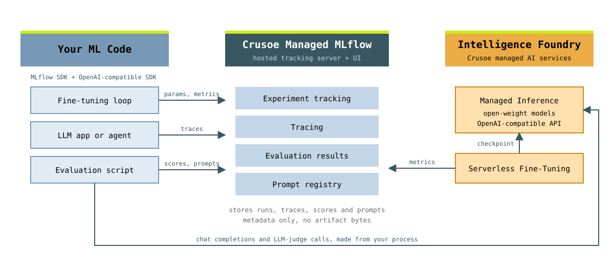

# Crusoe Managed MLflow

Examples for [Crusoe Managed MLflow](https://www.crusoe.ai/resources/blog/open-model-lifecycle): trace an LLM call, trace a LangChain chain, evaluate outputs with a Python scorer and an LLM judge, and version prompts. Everything runs through the standard MLflow SDK against your workspace, with model calls on Crusoe Managed Inference.

<picture>
  <source media="(prefers-color-scheme: dark)" srcset="assets/architecture-dark.svg">
  
</picture>

## Prerequisites

- [uv](https://docs.astral.sh/uv/getting-started/installation/)
- A Managed MLflow workspace and an API key, both created in the [Crusoe Console](https://console.crusoecloud.com/). Managed MLflow is in private preview; [request access](https://www.crusoe.ai/managed-mlflow/request) if it is not enabled for your organization yet.

## Setup

```bash
cd examples/cookbooks/managed-mlflow
uv sync
cp .env.example .env
```

Fill in `.env`. The same API key authenticates MLflow and the model calls, and the model ID must match the [available models](https://docs.crusoecloud.com/serverless-inference/available-models) list exactly.

```sh
# Crusoe Managed MLflow
MLFLOW_TRACKING_URI=https://api.mlflow.crusoecloud.com
MLFLOW_WORKSPACE=<your workspace name>
MLFLOW_EXPERIMENT_NAME=<your experiment name>

# Crusoe Managed Inference, for the model calls. The same key authenticates MLflow.
CRUSOE_API_KEY=<your crusoe api key>
MLFLOW_TRACKING_TOKEN=${CRUSOE_API_KEY}
CRUSOE_API_BASE=https://api.inference.crusoecloud.com/v1
CRUSOE_MODEL=Qwen/Qwen3.8-27B
```

## Run

Start with tracing:

```bash
uv run 01_tracing.py
```

Then open the MLflow UI from the Console, pick your workspace and experiment, and the trace is under the Traces tab.

Similarly, you can try the other samples: tracing with a request handler, tracing with LangChain, evaluation, and prompts. We will keep adding more as we go along.

## References

- [Launch blog](https://www.crusoe.ai/resources/blog/open-model-lifecycle)
- [MLflow GenAI guide](https://mlflow.org/docs/latest/genai/)
- [Crusoe Managed Inference](https://docs.crusoecloud.com/serverless-inference/index.html)
- [Cookbooks](../)
