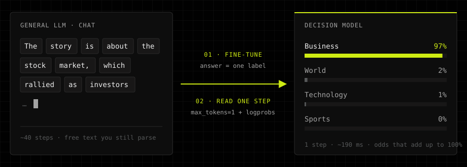

# Build your own decision model on Crusoe Cloud

A small model that picks from your list and says how sure it is. Built with Crusoe Serverless Fine-Tuning and Self-Serve Deployments.



**63% → 92%** of news stories sorted right: Qwen3.5-2B before and after a 7-minute fine-tune.

## What is a decision model?

A decision model doesn't write text. You give it some text and a list of options, and it picks one and tells you how sure it is. That fits any "which bucket?" job, like routing tickets, tagging emails or flagging unsafe content. It's **fast** (one step), **easy to trust** (you know when to hand off to a person) and **easy to plug in** (the answer is always one of your options).

### How does an LLM become one?

Before an LLM writes a word, it scores **every word it knows** (about 250,000 of them). We read only the scores for our four topics: Business, World, Technology and Sports.

Scores aren't percentages yet. To turn them into odds, raise *e* (about 2.72) to each score, then divide by the total:

```text
p_i = e^(s_i) / Σ_j e^(s_j)
```

Raising *e* to a score makes every number positive and lets the top score stand out. Dividing by the total makes the odds add up to 100%. For example:

| Topic | Score *s* | e^*s* | Odds |
| --- | ---: | ---: | ---: |
| **Business** | **5.2** | **181.3** | **97%** |
| World | 1.3 | 3.7 | 2% |
| Technology | 0.9 | 2.5 | 1% |
| Sports | −2.0 | 0.1 | 0% |
| Total | | 187.5 | 100% |

Business gets 181.3 ÷ 187.5 = 97%. That's the answer and its confidence, from one step.

So the recipe is: **fine-tune** the model to answer with just the topic name, then **read one step** of scores.

## How to build one on Crusoe

We taught Qwen3.5-2B to sort news into four topics. Each step shows the key part of its script: `01_prepare_data.py`, `02_finetune.py`, `03_deploy.py`, `decision_model.py`, and `04_eval.py`.

### 01 · Get the data ready

The one rule: **each topic name must start with a different token**. After fine-tuning, the first token picks the topic and the rest follows with near-100% certainty, so one step holds the odds for every topic. We built 8,000 examples from AG News.

```python
# No two topic names may start with the same token. Check before training.
first = {l: tokenizer.encode(l, add_special_tokens=False).ids[0] for l in LABELS}
assert len(set(first.values())) == len(LABELS), "two labels start with the same token"

# One training row: the article goes in, only the topic name comes out.
{"messages": [
    {"role": "system",    "content": SYSTEM},      # "...Respond with ONLY the category name"
    {"role": "user",      "content": article},
    {"role": "assistant", "content": "Business"},
]}
```

```bash
python 01_prepare_data.py
```

### 02 · Train it with Serverless Fine-Tuning

Estimated at $0.88. Finished in under 7 minutes.

```python
HPARAMS = {"n_epochs": 2, "batch_size": 64, "learning_rate": 1e-4,
           "lora_rank": 16, "lora_alpha": 32, "checkpoint_steps": 50}

job = client.fine_tuning.jobs.create(
    model=model, training_file=train_id, validation_file=val_id, suffix="agnews-decider",
    method={"type": "supervised", "supervised": {"hyperparameters": HPARAMS}})

# when it's done: keep the saved copy with the lowest loss on data it didn't train on
best = min(checkpoints, key=lambda k: k.metrics.valid_loss)
```

```bash
python 02_finetune.py create --model <model id> --yes
```

### 03 · Put it online with Self-Serve Deployment

Your own OpenAI-compatible endpoint, ready in about 4 minutes.

```python
body = {"flavor_id": flavor_id, "deployment_name": "agnews-decider", "replicas": 1,
        "fine_tuned_model": checkpoint_id}   # the docs' "fine_tuned_model_id" is silently ignored
client.post("/deployments", json=body)

# status check: make sure your trained model is attached
print(status, "| adapter:", dep.get("fine_tuned_model") or "NONE (base model only!)")
```

### 04 · Turn it into a decision model

Ask for one step and read the scores: `max_tokens=1` plus `logprobs`.

```python
resp = await client.post("/chat/completions", json={
    "model": "agnews-decider",
    "messages": [{"role": "system", "content": SYSTEM}, {"role": "user", "content": article}],
    "max_tokens": 1, "logprobs": True, "top_logprobs": 20,
})
scores = resp.json()["choices"][0]["logprobs"]["content"][0]["top_logprobs"]
odds = probabilities(scores)
```

`probabilities()` is the formula above, written as code:

```python
def probabilities(top_logprobs, labels=LABELS):
    seen = {}        # " Business" and "Business" are the same choice, so add them up
    for t in top_logprobs:
        key = t["token"].strip()
        seen[key] = log(exp(seen[key]) + exp(t["logprob"])) if key in seen else t["logprob"]
    peak = max(seen[l] for l in labels if l in seen)       # keeps the numbers small
    boost = {l: exp(seen[l] - peak) for l in labels if l in seen}
    total = sum(boost.values())
    return {l: boost.get(l, 0) / total for l in labels}   # each topic's share
```

Run it on a headline and you get the odds for every topic, plus a plain verdict (about 190 ms per call):

```text
$ python decision_model.py agnews-decider "Stocks rallied after the Fed held rates."
"Stocks rallied after the Fed held rates."
  Business    ████████████████████  99%  <- answer
  World       ▏                      1%
  Technology  ▏                      0%
  Sports                             0%
  Confident (at least 90%): act on it.
```

### 05 · Check it

Run it on 2,000 stories it has never seen:

```text
$ python 04_eval.py --model agnews-decider
In plain terms (2,000 stories the model never saw):
  - It sorted 92.2% of them correctly.
  - Acting only on answers it is at least 90% sure of covers 79.2% of stories, and 97.1% of those are right. Send the rest to a person.
  - Its confidence can be trusted: on average it is off by 0.6 points (ECE 0.006, lower is better).

Details:
       raw: acc 0.922  ECE 0.016  mean conf 0.937  (T=1.0)
calibrated: acc 0.922  ECE 0.006  mean conf 0.923  (T=1.15)
latency ms: {'p50': 186, 'p95': 217, 'mean': 190}
abstention (calibrated):
   confidence >= 0.0  covers 100.0% of traffic at 0.922 accuracy
   confidence >= 0.5  covers 98.9% of traffic at 0.928 accuracy
   confidence >= 0.7  covers 92.5% of traffic at 0.949 accuracy
   confidence >= 0.9  covers 79.2% of traffic at 0.971 accuracy
   confidence >= 0.95 covers 63.4% of traffic at 0.981 accuracy
   confidence >= 0.99 covers 26.7% of traffic at 0.981 accuracy
wrote results.json
```

Fine-tuning took it from 63% to 92%. The confidence lines are the useful part: if it only acts when it's at least 90% sure, it handles 79% of stories and gets 97% of those right. Send the rest to a person.

## Conclusion

Any LLM you fine-tune on Crusoe can be a decision model: train it to answer with one label, then read one step of scores. Ours went from 63% to 92% for about $1 of training. It works best with up to ~20 labels that each start with a different token, and you should check the odds on your own data before trusting a threshold.
