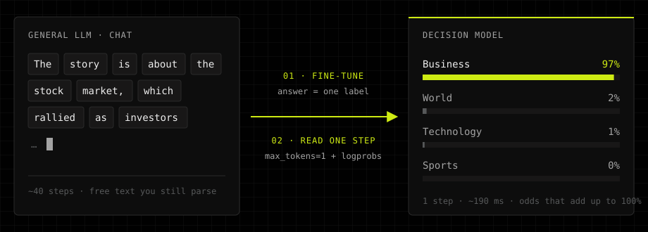

# Build a decision model

Fine-tune Qwen3.5-2B to sort news articles into four topics, deploy it on Crusoe, and read its answer as a probability for every option from one request. The fine-tuned model becomes a *decision model*: it picks one label from your list and says how sure it is, instead of writing free text.

The expected result is a deployment that returns `{choice, confidence, probabilities}` from a single `max_tokens=1` call, plus a measured comparison against the untrained model. In our run, accuracy on 2,000 held-out AG News articles went from 63.0% to 92.2%.



A step-by-step write-up with the math is in [BLOG.md](BLOG.md).

## How it works

Before an LLM writes a word, it scores every word it knows. Fine-tune the model to answer with just the label, then ask for one step (`max_tokens=1`, `logprobs=True`, `top_logprobs=20`) and keep only the scores of your labels. Turning those scores into odds is a softmax over the labels: raise *e* to each score and divide by the total, so the odds add up to 100%.

The one requirement is that **each label starts with a different token**. After fine-tuning, the first token picks the label and the rest of it follows with near-100% certainty, so the first token's odds are the label's odds. Crusoe Inference returns at most 20 `top_logprobs`, so one request covers up to 20 labels.

## Prerequisites

- Python 3.10 or newer with `venv` and `pip`, and internet access to Crusoe and Hugging Face. Training and serving run on Crusoe; a local GPU is not required.
- A Crusoe account with access to Serverless Fine-Tuning, Self-Serve Deployments, and Inference, and a Qwen3.5-2B flavor that is LoRA-suitable in your project.
- No Hugging Face token: the [AG News dataset](https://huggingface.co/datasets/fancyzhx/ag_news) and the Qwen3.5-2B tokenizer are public.

## Infrastructure, credentials, and configuration

This example creates uploaded training and validation files, a fine-tuning job with checkpoints, and a dedicated deployment.

| Variable | Purpose |
|---|---|
| `CRUSOE_API_KEY` | Required. Create one in [Inference API keys](https://console.crusoecloud.com/security/inference-api-keys). |
| `CRUSOE_PROJECT_ID` | Required for deployment steps. Copy it from the Console URL while viewing your project. |
| `TRUST_ENV` | Optional. Set to `1` if your network requires an HTTP proxy from the environment. |

Fine-tuning requests go to `https://api.intelligence.crusoecloud.com/v1`, deployment management to `https://api.crusoecloud.com/v1/projects/{project_id}/foundry/selfserve`, and inference to `https://api.inference.crusoecloud.com/v1`. The scripts save job, checkpoint, and deployment IDs to a local `run_state.json` so later steps can find them.

## Setup and execution

From the repository root:

```bash
cd examples/training/decision-model
python3 -m venv .venv
source .venv/bin/activate
python -m pip install -r requirements.txt
export CRUSOE_API_KEY='...' CRUSOE_PROJECT_ID='...'
```

Run the steps in order. Commands that spend money refuse to run without `--yes`, and print the payload and price first.

1. **Prepare the data.** `python 01_prepare_data.py` downloads AG News, checks that no two labels start with the same token, and writes `data/train.jsonl` (8,000 rows), `data/val.jsonl` (800), and `data/test.jsonl` (2,000).
2. **Fine-tune.** `python 02_finetune.py models` lists base models; copy the exact Qwen3.5-2B ID. Then run `estimate --model <id>` to upload the files and print the price estimate, and `create --model <id> --yes` to launch a two-epoch LoRA job. Poll with `status --watch`, then run `checkpoints` to pick the checkpoint with the lowest validation loss.
3. **Deploy.** `python 03_deploy.py flavors --base-model Qwen3.5-2B` lists flavors and prices. `create --flavor <id> --yes` creates a fused-LoRA deployment named `agnews-decider` with one replica, and `status --watch` waits until it is ready. The status line must show your adapter ID; `NONE` means the base model is being served.
4. **Decide.** `python decision_model.py agnews-decider "Stocks rallied after the Fed held rates."` prints a ranked bar chart of every label's probability and a plain verdict: act on the answer, or send it to a person. The cutoff is `--threshold` (default 0.9). Import `decide` or `decide_many` from [`decision_model.py`](decision_model.py) to use it in your own code.
5. **Evaluate.** `python 04_eval.py --model agnews-decider` scores the validation and test sets, fits one calibration temperature on validation, and writes `results.json`.
6. **Clean up.** Follow the steps below.

The deployment create body uses `fine_tuned_model`, the field name in the API spec. The documentation's `fine_tuned_model_id` is ignored without an error, which leaves the deployment serving the base model.

## Expected output

- Three local JSONL files with the row counts above, and the token IDs of the four labels.
- Uploaded file IDs, a price estimate, a fine-tuning job ID, and a checkpoint table with training and validation loss.
- For each article, a ranked bar chart and a verdict:

```text
"Stocks rallied after the Fed held rates."
  Business    ████████████████████  99%  <- answer
  World       ▏                      1%
  Technology  ▏                      0%
  Sports                             0%
  Confident (at least 90%): act on it.
```

- Evaluation output like this, from our run on November 19, 2026:

```text
In plain terms (2,000 stories the model never saw):
  - It sorted 92.2% of them correctly.
  - Acting only on answers it is at least 90% sure of covers 79.2% of stories, and 97.1% of those are right. Send the rest to a person.
  - Its confidence can be trusted: on average it is off by 0.6 points (ECE 0.006, lower is better).

Details:
       raw: acc 0.922  ECE 0.016  mean conf 0.937  (T=1.0)
calibrated: acc 0.922  ECE 0.006  mean conf 0.923  (T=1.15)
latency ms: {'p50': 186, 'p95': 217, 'mean': 190}
abstention (calibrated):
   confidence >= 0.9  covers 79.2% of traffic at 0.971 accuracy
   confidence >= 0.95 covers 63.4% of traffic at 0.981 accuracy
```

The abstention lines show the value of the probabilities: acting only on answers with at least 90% confidence handles 79% of articles at 97% accuracy, and the rest can go to a person. Scores depend on the training run; the example does not assert a target score.

## Costs and cleanup

Fine-tuning bills per trained token, the deployment per GPU-hour until it is deleted, and evaluation per inference request. Our run's price estimate was $0.88 for training, and the Qwen3.5-2B throughput flavor cost $5.50 per hour. Check current prices in the Console before creating resources.

1. Delete the deployment with `python 03_deploy.py delete --yes`. Billing stops only when the deployment is deleted; it returns 404 once it is gone.
2. Delete the uploaded files in [Datasets](https://console.crusoecloud.com/foundry/datasets) if you no longer need them. Fine-tuned checkpoints remain in the model registry.
3. Local files (`data/`, `run_state.json`, `results.json`) and `.venv` remain; remove them when no longer needed. Keep credentials out of Git.

## Validation

On November 19, 2026, the full workflow ran against Crusoe: data preparation, fine-tuning (succeeded, 1,755,774 trained tokens, best checkpoint at step 250 with validation loss 0.0795), deployment, inference, evaluation, and deployment deletion. The untrained baseline (63.0%) was measured on the same deployment before the adapter was attached.

Live model availability, flavors, prices, and account access still need verification in your environment.

## References

- [Serverless Fine-Tuning documentation](https://docs.crusoecloud.com/serverless-fine-tuning/overview) and [API reference](https://docs.crusoecloud.com/api/managed-ai/#tag/Fine-tuning)
- [Self-Serve Deployments documentation](https://docs.crusoecloud.com/self-serve-deployments/overview)
- [AG News dataset](https://huggingface.co/datasets/fancyzhx/ag_news) and [Qwen/Qwen3.5-2B model](https://huggingface.co/Qwen/Qwen3.5-2B)
- [Training examples](../)
