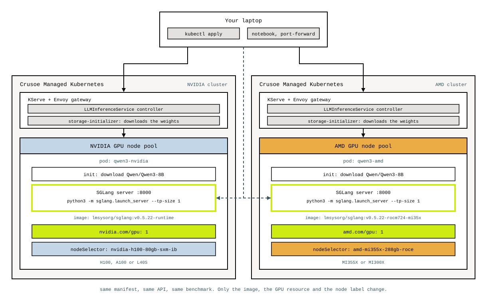

# Serve, Measure, Tune: SGLang on Crusoe Managed Kubernetes

You deploy an open-weight model, [Qwen3-8B](https://huggingface.co/Qwen/Qwen3-8B), as a production-style inference endpoint on your own NVIDIA H200 GPU: one Kubernetes object, served by [SGLang](https://docs.sglang.io/) through [KServe](https://kserve.github.io/website/) on [Crusoe Managed Kubernetes](https://docs.crusoe.ai/orchestration/cmk/overview). You chat with it, look inside the engine, benchmark it, then tune it (FP8 KV cache, scheduling) and see your results next to everyone else's on the results wall. The instructors run the same manifest on an AMD MI355X to show what changes, and what does not, when the GPU vendor changes.

<div align="center"></div>

Everything runs from your laptop with `kubectl` and a Jupyter notebook. You get your own namespace (`ws-NN`) with exactly one GPU; you cannot see or touch anyone else's.

## Before the session

Bring a laptop with macOS or Linux. On Windows, use [WSL2](https://learn.microsoft.com/windows/wsl/install) with Ubuntu (best effort: it works, but the instructors test on macOS and Linux), or pair up with someone who has macOS or Linux. Install these:

| Tool | Install | Check |
|---|---|---|
| `uv` | [docs.astral.sh/uv](https://docs.astral.sh/uv/getting-started/installation/) | `uv --version` |
| `kubectl` | [kubernetes.io/docs/tasks/tools](https://kubernetes.io/docs/tasks/tools/) | `kubectl version --client` |
| `git` | [git-scm.com/downloads](https://git-scm.com/downloads) | `git --version` |

Then get the code and the environment (Python and every package come from `uv`; nothing is installed system-wide):

```bash
git clone https://github.com/crusoecloud/crusoe-developer-hub.git
cd crusoe-developer-hub/examples/workshop/sglang-kubernetes-workshop/workshop
uv sync
```

## Start (first 5 minutes of the session)

Your desk has a card with a passcode (four groups of four characters). It is your login to the cluster: keep it to yourself.

```bash
cd crusoe-developer-hub/examples/workshop/sglang-kubernetes-workshop/workshop
git pull                              # the latest version, including where to download the login bundle
./login.sh K7F2-XQ9M-HC4T-W8PA        # the passcode on your card; case, dashes and spaces do not matter
./check.sh                            # login.sh already ran it; run it again any time
uv run jupyter lab
```

`login.sh` downloads the workshop's login bundle, unlocks your desk's access with the passcode and checks it against the cluster. It then asks for your email (required: we send you the workshop materials; [Crusoe privacy notice](https://legal.crusoe.ai/#website-privacy-notice)), a display name, whether to show that name on the results screen (default no) and whether Crusoe may contact you about Crusoe Cloud (default no). It saves your kubeconfig to `~/.sglang-workshop/kubeconfig` and ends with `check.sh`: one line per check, then `OK` or "ask an instructor". Running it again is safe and tells you what changed.

In JupyterLab, open **`notebooks/01_Deploy.ipynb` and run the three cells under *Start here* right away**: they check your access and start your model server (the instructors may already have started it for you before the session; then the cell says so). It takes a few minutes to come up, longer when everyone deploys at the same moment, so start it now and let it load during the talk.

The notebooks and `check.sh` find the saved kubeconfig by themselves. For `kubectl` in a terminal, run `export KUBECONFIG=~/.sglang-workshop/kubeconfig` (once per terminal). If `KUBECONFIG` is already set to something else, it wins: `unset KUBECONFIG` before `uv run jupyter lab`.

If the download fails (the venue network, or the bundle is no longer online), the help desk gives you a copy of the bundle or a kubeconfig file:

```bash
./login.sh --bundle ~/Downloads/bundle.enc K7F2-XQ9M-HC4T-W8PA   # a copy of the bundle, plus your passcode
./login.sh --file ~/Downloads/kubeconfig-ws-NN.yaml              # a kubeconfig handed to you directly
```

Both ask the same questions and end in the same place.

**On Windows with WSL2:**

1. Install `uv`, `kubectl` and `git` inside the Ubuntu terminal with the Linux instructions, and run every command there, not in PowerShell. The Windows versions of the tools do not see your WSL files.
2. Keep the repository in your Linux home (`~`), not under `/mnt/c`: there, `uv sync` is slow and `./login.sh` and `./check.sh` can lose their execute permission. A file from the help desk lands in Windows; copy it in first: `cp /mnt/c/Users/<you>/Downloads/bundle.enc ~/`.
3. Open the links that JupyterLab and the chat UI print (`http://localhost:…`) in your Windows browser: WSL2 forwards `localhost` to Windows.

## Session plan

| When | What | Time |
|---|---|---|
| Before the talk | `./login.sh <passcode>`, then the deploy cells of `01_Deploy` | ~5 min |
| Talk | Your server is created, downloads the model and loads | 15 min |
| Hands-on 1 | [`notebooks/01_Deploy.ipynb`](notebooks/01_Deploy.ipynb): how the manifest works, chat with the model (thinking on and off), look inside the engine, baseline benchmark (256 users, then 1 user), submit the baseline | ~15 min |
| Hands-on 2 | [`notebooks/02_Tune.ipynb`](notebooks/02_Tune.ipynb). Core ≈ 8 min (FP8): one change redeployed and benchmarked against your baseline; HiCache to try at home. Optional ≈ 15 min (cap the running batch at 128 ≈ 5½, try your own settings ≈ 6, restore baseline ≈ 3½) | ~8–23 min |
| End | Everyone's results on the results wall; the chat UI in your browser | ~5 min |

The results wall compares one standard benchmark, the same for everyone: 384 requests of exactly 4096 random tokens in and 512 out, 256 at a time (about 2 minutes, after a short warm-up). That is more KV cache than one H200 holds in bf16, so the benchmark shows what serving under load costs. The notebooks run it for you and submit the result.

## What to expect

- **Deploying:** the notebook first says "waiting for KServe to create your pod": KServe handles one deploy at a time, so when everyone deploys together you wait your turn (a few minutes at most). Then the model downloads (~1 min) and loads (~1.5 min). The download sometimes takes up to 10 minutes; read the notebook while it loads.
- **Changing a setting (redeploy):** usually 3 to 4 minutes, up to about 10 when the model download is slow. You have one GPU, so the notebook stops your server, applies the change and starts it again. Read the explanation in the notebook while it waits.
- **Benchmark:** about 2 minutes per standard run, measured inside your pod; it prints a dot every 5 seconds while it runs. It keeps running if your laptop sleeps or loses Wi-Fi.

## Troubleshooting

| You see | What to do |
|---|---|
| `login failed: the workshop login opens at the start of the session` | The login is not open yet; run `./login.sh` again once the session starts |
| `login failed: wrong passcode` | Check it against your card and type it again. Cards never use 0, O, 1, I or L |
| `login failed: download failed` or `network unreachable` | Check your Wi-Fi and run `./login.sh` again; if it keeps failing, get the bundle from the help desk and use `./login.sh --bundle <file> <passcode>` |
| `login failed: the workshop environment is not set up` | Run `uv sync` in the workshop folder (it needs the internet once), then `./login.sh` again |
| `check.sh`: `not logged in` or `no namespace` | Run `./login.sh <passcode>` (or `unset KUBECONFIG` if it points at another file), then re-run |
| `revoked or has expired` / `Unauthorized` / `You must be logged in to the server` | Your desk's access was reset or has expired; ask an instructor for a spare card |
| `Forbidden` | You tried something outside your namespace or not allowed in the workshop (for example creating a Service, a volume, or another GPU pod). The notebooks never need it; ask if a cell fails with this |
| `port 8001 busy, using 8003 instead` (or `check.sh` warns a port is busy) | Nothing to do: another program on your laptop holds that port, so the notebook uses the next free one. The chat UI prints the address it actually uses |
| A benchmark cell stops with "the connection to the cluster was lost during the benchmark" | Your laptop slept or lost Wi-Fi. Re-run the cell: the benchmark runs inside your pod, so it uses the finished result, or waits for the run still going, instead of starting again |
| `ports … are all in use by other programs` | Start from another range before starting Jupyter: `export WORKSHOP_LOCAL_PORT=9001` and/or `export WORKSHOP_CHAT_PORT=9080` |
| "waiting for KServe to create your pod" for a few minutes | Normal when everyone deploys at once; the queue drains by itself |
| `exceeded quota: … requests.nvidia.com/gpu` | Another pod is holding your one GPU. `kubectl get pods`, then `kubectl delete pod <the extra one>` |
| Status `Init:storage-initializer` | The 16 GB model is downloading (~1 min; sometimes up to 10 minutes, nothing to fix) |
| Status `Running` but not `Ready` | The model is loading and CUDA graphs are being captured (~1.5 min) |
| Your change "did nothing" | Use the notebook's redeploy cell, not a plain `kubectl apply` (see below) |
| `bench_serving` (kubectl path) returns 404 | `--model` must match what `/v1/models` lists: `qwen3` |
| `bench_serving` fails with `LocalEntryNotFoundError` | The `random` dataset downloads text from the Hub, which your pod cannot reach. Use `--dataset-name random-ids` |
| The chat page does not open | Open the address the notebook prints (usually `http://127.0.0.1:8080`, or the next free port if that one was busy) |

`kubectl describe resourcequota gpu-quota` shows what your namespace is using, and `kubectl get pods` your pods.

## Without the notebook: kubectl only

[`manifests/sglang-qwen3-nvidia.yaml`](manifests/sglang-qwen3-nvidia.yaml) is the same service the notebook deploys (name `qwen3`, your namespace from the kubeconfig, the H200 pool). From this folder:

```bash
export KUBECONFIG=~/.sglang-workshop/kubeconfig          # saved by login.sh
kubectl apply -f manifests/sglang-qwen3-nvidia.yaml
kubectl get llminferenceservice qwen3 -w                 # wait for READY True
kubectl port-forward svc/qwen3-kserve-workload-svc 8001:8000 &
curl -s http://127.0.0.1:8001/v1/chat/completions -H 'Content-Type: application/json' \
  -d '{"model": "qwen3", "messages": [{"role": "user", "content": "Hello"}], "max_tokens": 64}'
kubectl exec deploy/qwen3-kserve -c main -- \
  python3 -P -m sglang.bench_serving --backend sglang --host 127.0.0.1 --port 8000 --model qwen3 \
  --tokenizer /mnt/models --dataset-name random-ids --random-input-len 4096 --random-output-len 512 \
  --random-range-ratio 1.0 --num-prompts 384 --max-concurrency 256 --seed 42
```

To change a setting, edit a copy of the manifest and redeploy without a second GPU:

```bash
kubectl annotate llminferenceservice qwen3 serving.kserve.io/stop=true --overwrite   # stop; wait until `kubectl get pods` shows no qwen3 pod
kubectl apply -f my-change.yaml
kubectl annotate llminferenceservice qwen3 serving.kserve.io/stop-                  # start again
```

A plain `kubectl apply` of a changed manifest never finishes: the new pod would need a second GPU while the old one keeps running the old settings.

The browser chat also runs without Jupyter: `uv run python notebooks/chat_ui.py`, then open the address it prints (usually <http://127.0.0.1:8080>).

## After the session

The instructors delete your namespace, with your server and your results, right after the session, and your access expires within 24 hours, so there is nothing to clean up on the cluster. On your laptop, `rm -rf ~/.sglang-workshop` removes the saved kubeconfig.

## Versions

SGLang `v0.5.22` (`lmsysorg/sglang:v0.5.22-runtime`), KServe `v0.19.0`, Qwen3-8B (Apache-2.0, 16 GB in bf16), NVIDIA H200 141GB, Kubernetes 1.35. Instructors: contact the Crusoe team.

## Further reading

- [SGLang documentation](https://docs.sglang.io/): [server arguments](https://docs.sglang.io/advanced_features/server_arguments.html), [hyperparameter tuning](https://docs.sglang.io/advanced_features/hyperparameter_tuning.html), [HiCache](https://docs.sglang.io/advanced_features/hicache_best_practices.html), [benchmarking](https://docs.sglang.io/developer_guide/benchmark_and_profiling.html)
- [KServe LLMInferenceService](https://kserve.github.io/website/docs/model-serving/generative-inference/llmisvc/llmisvc-overview)
- [Crusoe Managed Kubernetes](https://docs.crusoe.ai/orchestration/cmk/overview)

[All workshops](../../README.md) | [All examples](../../../README.md) | [Back to the hub](../../../../README.md)
