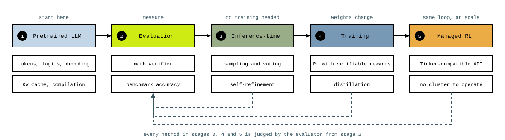

# Post-Training with RL: From Scratch to Managed RL

A hands-on track on post-training a language model to reason, built in plain PyTorch. It starts from a pretrained 0.6-billion-parameter open model, builds the evaluation that every later step is judged by, and works toward reinforcement learning with verifiable rewards, first on a single GPU and finally through [Crusoe Managed RL (in preview now)](https://www.crusoe.ai/resources/blog/open-model-lifecycle) with a Tinker-compatible API, where the same loop runs without operating a cluster.

Two books make good companions to this track, which follows the ground they cover: [Build a Reasoning Model (From Scratch)](https://sebastianraschka.com/books/) by Sebastian Raschka and [Reinforcement Learning from Human Feedback](https://rlhfbook.com/) by Nathan Lambert. Read them alongside the notebooks for the longer treatment of each idea.

<div align="center"></div>

## Notebooks

Run them in order the first time. Each one loads its own model and data, so you can also open any of them directly.

| Status | Notebook | Stage |
|:---:|---|---|
|  | [What is a reasoning model?](01_ReasoningModels.ipynb) | 0. orientation: the vocabulary, the conventional training pipeline, three routes to better reasoning, and a base model against a reasoning model on the same questions |
|  | [Text generation from scratch](02_TextGeneration.ipynb) | 1. pretrained LLM: tokenizer, one forward pass, the decoding loop, a KV cache, and the one-line `torch.compile` speedup |
|  | [Evaluating reasoning with a math verifier](03_MathVerifier.ipynb) | 2. evaluation: the four evaluation methods, a four-stage verifier, a MATH-500 harness, and a prompt-sensitivity experiment |
|  | [Sampling and self-consistency](04_SamplingAndVoting.ipynb) | 3. inference-time: a step-by-step prompt, temperature and top-p sampling inside the decoding loop, majority voting over sampled chains, and the cost of each on MATH-500 |
|  | [Scoring and self-refinement](05_SelfRefinement.ipynb) | 3. inference-time: a rule-based score, token log-probabilities and a confidence score, best-of-n selection, a critique-and-rewrite loop with a score at the gate, and all of it on MATH-500 |
|  | [RLVR using GRPO](06_GRPO.ipynb) | 4. training: RLVR, reinforcement learning with verifiable rewards, in place of human feedback; sampled rollouts, group-relative advantages, sequence log-probabilities with gradients, the GRPO loss and one update, a hundred-step training run on one GPU, and the result on MATH-500 |
|  | Stabilizing GRPO | 4. training |
|  | Distillation | 4. training |
|  | The same RL loop on a managed service | 5. managed RL |

A yellow check means the notebook is available and runs end to end; a dashed box is a planned topic.

The helper package `reasoning_utils` next to the notebooks holds the transformer, the tokenizer wrapper, downloads, and the functions each notebook promotes for the next one to import. `scripts/evaluate_math500.py` runs the full benchmark from the command line, greedy, with sampling and voting, with best-of-n selection, with self-refinement, or on a trained checkpoint; `scripts/train_grpo.py` runs the GRPO loop with checkpoints. `tests/` holds offline checks of the helper package for maintainers; the notebooks do not depend on them.

## Setup

### Create a VM with an NVIDIA GPU on Crusoe Cloud

Sign in to the [Crusoe Console](https://console.crusoecloud.com/) and follow the [VM creation guide](https://docs.crusoecloud.com/quickstart/creating-a-vm/index.html). Choose a GPU instance and an image with NVIDIA drivers, add your SSH key, and leave room on the boot disk for the model downloads (about 3 GB). Everything in this track was tested on a single L40S, which is enough to follow along end to end. Connect with the instance's public IP:

```bash
ssh ubuntu@<PUBLIC_IP>
```

See [Accessing your VMs](https://docs.crusoecloud.com/compute/virtual-machines/accessing-vms/index.html) for details. A VM and its storage incur charges while they exist; delete what you no longer need after saving your work.

### Install the environment

The track uses [`uv`](https://docs.astral.sh/uv/) for Python and dependencies. Model weights and the benchmark download from the Hugging Face Hub on first use and are cached in your home directory. No Crusoe API key is required.

```bash
curl -LsSf https://astral.sh/uv/install.sh | sh
git clone https://github.com/crusoecloud/crusoe-developer-hub.git
cd crusoe-developer-hub/foundations/post-training/02-post-training-rl-model
uv sync
```

`uv sync` creates `.venv/` here from `pyproject.toml` and `uv.lock`, fetching Python 3.12 if needed.

### Run the notebooks

```bash
uv run jupyter lab
```

Open the notebooks from JupyterLab and pick the default Python 3 kernel. If the VM is remote, forward the port (`ssh -L 8888:localhost:8888 ubuntu@<PUBLIC_IP>`) and open the printed URL locally.

## Cleanup

Stop Jupyter when finished. Evaluation logs land in `outputs/` and are ignored by git. Model and dataset downloads stay in the Hugging Face cache. Closing Jupyter does not remove the VM or its disk.

## Further reading

Many resources went into this track: papers, model reports, open-source training code, and books on language models and reinforcement learning. Each notebook ends with the references most relevant to its topic. Good starting points:

- [Build a Reasoning Model (From Scratch)](https://sebastianraschka.com/books/) by Sebastian Raschka, the companion book for the from-scratch path through generation, evaluation, inference-time scaling, and GRPO
- [Reinforcement Learning from Human Feedback](https://rlhfbook.com/) by Nathan Lambert, the companion book for the reinforcement learning side: rewards, policy gradients, and what the current post-training recipes look like
- [DeepSeek-R1: Incentivizing Reasoning Capability in LLMs via Reinforcement Learning](https://arxiv.org/abs/2501.12948)
- [DeepSeekMath](https://arxiv.org/abs/2402.03300), where GRPO was introduced
- [Qwen3 Technical Report](https://arxiv.org/abs/2505.09388) and the [Qwen3-0.6B-Base](https://huggingface.co/Qwen/Qwen3-0.6B-Base) and [Qwen3-0.6B](https://huggingface.co/Qwen/Qwen3-0.6B) model cards
- [Let's Verify Step by Step](https://arxiv.org/abs/2305.20050)
- [Scaling LLM Test-Time Compute Optimally Can Be More Effective Than Scaling Model Parameters](https://arxiv.org/abs/2408.03314)

[All foundations](../../README.md)
